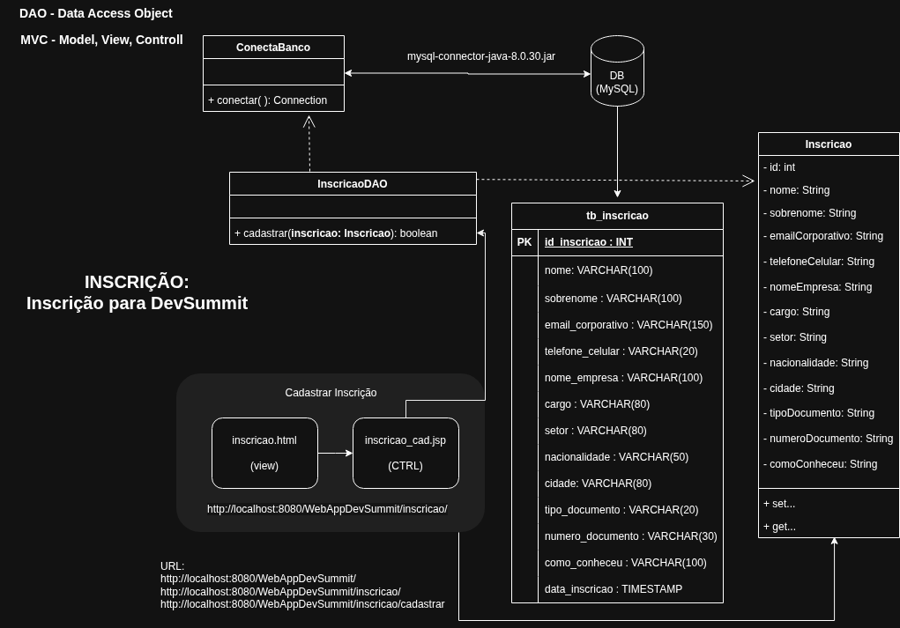

# 🚀 WebAppDevSummit - Sistema de Inscrição em Eventos

O **WebAppDevSummit** é uma aplicação web desenvolvida em Java no padrão **MVC (Model-View-Controller)** para gerenciamento de inscrições de participantes em conferências e summits de tecnologia. O sistema permite o cadastro completo de inscritos, persistindo os dados em um banco de dados **MySQL** por meio do padrão **DAO (Data Access Object)**.

---

## 📸 Diagramas do Sistema

### 1. Arquitetura do Sistema com bd incluso (MVC)


---

## 🛠️ Tecnologias Utilizadas

* **Linguagem:** Java (JDK 8 ou superior)
* **Servidor / Container:** Apache Tomcat
* **Tecnologia Web:** JSP (JavaServer Pages) & HTML5 / CSS3
* **Persistência & Banco de Dados:** JDBC (Java Database Connectivity) e MySQL
* **IDE de Desenvolvimento:** Apache NetBeans IDE
* **Controle de Versão:** Git & GitHub

---

## 🗄️ Script SQL (Banco de Dados)

Execute o script abaixo no seu SGBD MySQL (MySQL Workbench ou phpMyAdmin) para criar a estrutura do banco e da tabela:

```sql
-- 1. Criação do Banco de Dados
CREATE DATABASE IF NOT EXISTS `db_devsummit`
DEFAULT CHARACTER SET utf8mb4
DEFAULT COLLATE utf8mb4_unicode_ci;

USE `db_devsummit`;

-- 2. Criação da Tabela de Inscrições
CREATE TABLE IF NOT EXISTS `tb_inscricao` (
  `id_inscricao` INT NOT NULL AUTO_INCREMENT,
  `nome` VARCHAR(100) NOT NULL,
  `sobrenome` VARCHAR(100) NOT NULL,
  `email_corporativo` VARCHAR(150) NOT NULL,
  `telefone_celular` VARCHAR(20) NOT NULL,
  `nome_empresa` VARCHAR(100) NOT NULL,
  `cargo` VARCHAR(50) NOT NULL,
  `setor` VARCHAR(50) NOT NULL,
  `nacionalidade` VARCHAR(50) NOT NULL,
  `cidade` VARCHAR(50) NOT NULL,
  `tipo_documento` VARCHAR(20) NOT NULL,
  `numero_documento` VARCHAR(30) NOT NULL,
  `como_conheceu` VARCHAR(50) NOT NULL,
  `data_inscricao` TIMESTAMP DEFAULT CURRENT_TIMESTAMP,
  PRIMARY KEY (`id_inscricao`)
) ENGINE=InnoDB DEFAULT CHARSET=utf8mb4;
```

---

## 📊 Estrutura dos Campos da Tabela (`tb_inscricao`)

| Campo | Tipo | Descrição |
| :--- | :--- | :--- |
| `id_inscricao` | `INT` (PK, Auto Increment) | Chave primária e identificador do participante |
| `nome` | `VARCHAR(100)` | Nome do inscrito |
| `sobrenome` | `VARCHAR(100)` | Sobrenome do inscrito |
| `email_corporativo` | `VARCHAR(150)` | E-mail corporativo para contato e validações |
| `telefone_celular` | `VARCHAR(20)` | Telefone móvel / WhatsApp |
| `nome_empresa` | `VARCHAR(100)` | Nome da organização ou empresa |
| `cargo` | `VARCHAR(50)` | Cargo ou função na empresa |
| `setor` | `VARCHAR(50)` | Área de atuação |
| `nacionalidade` | `VARCHAR(50)` | País de origem do inscrito |
| `cidade` | `VARCHAR(50)` | Cidade de residência |
| `tipo_documento` | `VARCHAR(20)` | Documento de identificação (CPF, Passaporte ou RNE) |
| `numero_documento` | `VARCHAR(30)` | Número correspondente ao documento |
| `como_conheceu` | `VARCHAR(50)` | Canal por onde conheceu o evento |
| `data_inscricao` | `TIMESTAMP` | Data e hora exatas da submissão do formulário |

---

## 📁 Estrutura do Projeto

```
WebAppDevSummit/
├── docs/
│   ├── arquitetura.png              # Imagem do diagrama da arquitetura MVC
│   └── der.png                      # Imagem do diagrama de banco de dados
├── src/
│   └── java/
│       ├── conexao/
│       │   └── ConectaBanco.java    # Classe de conexão JDBC com o MySQL
│       ├── dao/
│       │   └── InscricaoDAO.java    # Data Access Object (Operações SQL)
│       └── model/
│           └── Inscricao.java       # Entidade de domínio (JavaBeans)
├── web/
│   ├── META-INF/
│   ├── WEB-INF/
│   ├── inscricao.html               # Form de cadastro
│   └── inscricao_cad.jsp            # Processamento do formulário e controller
└── README.md
```

---

## 💻 Como Executar o Projeto

1. **Configurar o Banco de Dados:**
   * Execute o script SQL disponibilizado acima no seu MySQL para criar o banco `db_devsummit` e a tabela `tb_inscricao`.

2. **Adicionar o Driver JDBC:**
   * Adicione o driver `mysql-connector-j.jar` (ou `mysql-connector-java.jar`) na pasta de bibliotecas (*Libraries*) do projeto no NetBeans.

3. **Configurar as Credenciais:**
   * Ajuste o usuário e a senha do banco de dados na classe `conexao.ConectaBanco`.

4. **Executar na IDE:**
   * Abra o projeto no **Apache NetBeans IDE**.
   * Execute o projeto no servidor **Apache Tomcat** (`Shift + F6` ou clicar em *Run Project*).

---

Desenvolvido por **Danilo Carvalho** (`daniilocl`).